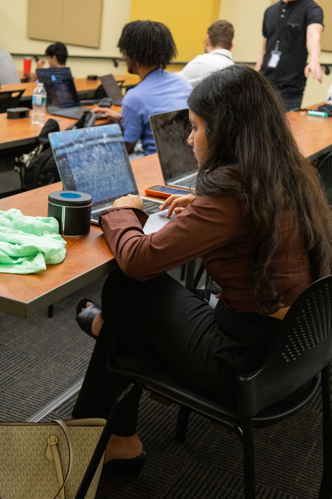

# StillHere

A quick EEG test to check if a patient who seems unresponsive can follow a simple instruction, without moving. Built at the USF BCI Club Build Sprint (Nov 7, 2026).

Some patients who look unresponsive (eyes open, no movement) are actually aware. Bedside exams ask them to move, so if they can't move they fail. In a 2024 NEJM study of 241 patients who didn't respond to commands, about 1 in 4 could still do imagined-movement tasks on fMRI or EEG.

StillHere tries this with vision: a laptop screen and the 4 dry sensors of a g.tec Unicorn BCI Core-4 on the back of the head.

<p align="center">
  
  <br>
  <sub>Building StillHere at the USF BCI Club Build Sprint, Nov 7, 2026. <a href="https://www.linkedin.com/posts/maria-antonia-piedrah%C3%ADta-l%C3%B3pez_bci-braincomputerinterface-neurotechnology-ugcPost-7525972648343011328-GdrM/">See the event post on LinkedIn</a>.</sub>
</p>

## Contents

1. [Set up a new laptop](#1-set-up-a-new-laptop) (about 10 minutes)
2. [Check the install](#2-check-the-install)
3. [Try it without the headset](#3-try-it-without-the-headset)
4. [Connect the headset](#4-connect-the-headset-unicorn-bci-core-4)
5. [Run the demo](#5-run-the-demo)
6. [What the person wearing the headset does](#6-what-the-person-wearing-the-headset-does)
7. [Troubleshooting](#7-troubleshooting)
8. [How it works and the rules](#8-how-it-works)

**You need:** a Mac (Apple chip) or a Windows laptop, **Python 3.10 to 3.13** (3.12 recommended), **Google Chrome**, and for the real test the **g.tec Unicorn BCI Core-4** headset (ours: serial `U4-2025.10.50`). No internet is needed once the packages are installed.

---

## 1. Set up a new laptop

### Mac

1. **Install Python 3.12** if you don't have it. Check first in Terminal: `python3 --version`. If it says 3.9 or lower, or "command not found", install 3.12 from [python.org/downloads](https://www.python.org/downloads/) (run the installer, then open a new Terminal window).
2. **Unzip and install** (paste line by line in Terminal):
   ```bash
   cd ~/Downloads
   unzip -o stillhere.zip
   cd stillhere
   python3 -m venv .venv
   source .venv/bin/activate
   pip install --upgrade pip
   pip install -r requirements.txt
   pip install "gpype[all]"
   ```
   Your prompt now starts with `(.venv)`. Every time you open a new Terminal window, go back in with:
   ```bash
   cd ~/Downloads/stillhere && source .venv/bin/activate
   ```
3. **Give Bluetooth permission** (needed for the headset): System Settings > Privacy & Security > **Bluetooth** > turn on **Terminal** (or VS Code, if you run it from there). Without this the headset scan finds nothing and gives no error.

### Windows

1. **Install Python 3.12** from [python.org/downloads](https://www.python.org/downloads/). In the installer, tick **"Add python.exe to PATH"**.
2. **Unzip** `stillhere.zip` (right-click > Extract All) into `Downloads`, then open **PowerShell** and run:
   ```powershell
   cd $HOME\Downloads\stillhere
   py -3.12 -m venv .venv
   .venv\Scripts\activate
   python -m pip install --upgrade pip
   pip install -r requirements.txt
   pip install "gpype[all]"
   ```
   If PowerShell says running scripts is disabled, run this once and try again: `Set-ExecutionPolicy -Scope CurrentUser RemoteSigned`.
   Every new PowerShell window: `cd $HOME\Downloads\stillhere; .venv\Scripts\activate`

---

## 2. Check the install

```bash
python scripts/selfcheck.py
```

Every line should say `OK`. It checks Python, the packages, the bundled fonts, and that the signal analysis finds the attended side on test data. If anything says `FIX` or `NOTE`, it tells you the exact command to run.

---

## 3. Try it without the headset

```bash
python -m blindspot.server --source sim --min-gap-hours 0
```

Open **http://localhost:8765** in **Chrome** (Safari can cap the frame rate, and the safety check will stop the run). It opens on the **About** page; click **Live demo** at the top. A 4-step checklist across the top of the demo page shows what's done and what to do next (connect, check sensors, headset check, run a test). Press **Ctrl+C** in the terminal to stop the server.

`--min-gap-hours 0` turns off the one-run-per-12-hours rule so you can practice. To see each result screen, restart with one of these:

```bash
python -m blindspot.server --source sim --min-gap-hours 0                      # follows commands: Pass 1 of 2, then Refer
python -m blindspot.server --source sim --min-gap-hours 0 --sim-mode blind     # Step 1 stop: "Not interpretable" (both tests)
python -m blindspot.server --source sim --min-gap-hours 0 --sim-mode nofollow  # ignores commands: "No conclusion"
python -m blindspot.server --source sim --min-gap-hours 0 --sim-mode stuck     # always picks left: "No conclusion"
```

Set **s per trial** to 6 for a quick look (about 2 minutes per run).

---

## 4. Connect the headset (Unicorn BCI Core-4)

1. **Charge and turn on.** Dock the amplifier on its magnetic base. A **fading light** means it's ready to connect, **short blinks** mean connected. It won't turn on while the USB cable is plugged in; if the light doesn't fade, charge it (a full charge takes about 3 hours).
2. **Put it on.** Wear the band so all 4 sensors sit on the **back of the head**, just above the bony bump. Part the hair under each comb so it touches the scalp.
3. **Check the signal** (g.tec's own live scope):
   ```bash
   python scripts/check_headset.py
   ```
   You should see **4 wavy lines**. Close your eyes for 10 seconds: the lines should get bigger and more rhythmic (alpha waves), then calm down when you open them. A flat or wild line means that sensor needs better contact. Close the window when done.
4. **Start the stream and the app** in **two terminals**, with the venv active in both:
   ```bash
   # Terminal 1: headset -> stream (leave it running)
   python scripts/stream_core.py

   # Terminal 2: the app
   python -m blindspot.server --source lsl --min-gap-hours 0
   ```
   Open **http://localhost:8765** in Chrome, click **Live demo**. The header should say **BCI Core · g.Pype** and **4 ch · 250 Hz**, and the brain view shows sensors S1 to S4 on the back of the head.
5. **Headset check:** click **Headset check** and look *directly* at the left panel, then the right panel. The live left and right bars should clearly swap. Press **Esc** to stop. If they don't swap, fix the sensor contact before testing.

The scripts open the headset with 4 channels and our serial, so they never grab another team's headset. For a different headset: `python scripts/stream_core.py --serial U4-XXXX.XX.XX` (or `--channels 8` for a Core-8).

---

## 5. Run the demo

1. Start the app **without** `--min-gap-hours 0`, so the real rule is on:
   ```bash
   python -m blindspot.server --source lsl
   ```
2. Use a **fresh Patient ID** (one scored run per patient every 12 hours).
3. Pick **Command test**, **Yes / No test**, or **Eyes-closed test**. Each one first opens an instructions screen: what to read to the person (there's a "Read it out loud for me" button), a short checklist, and a required safety tick for the flicker tests. **Start test** opens full screen.
4. Show the failures on purpose: eyes closed gives "Not interpretable"; ignoring the voice or always attending left gives "No conclusion".
5. **Print report** prints the sheet with every run for that patient.

Every run is saved in `recordings/` (raw EEG `.npz`, a trial log `.json`, and `ledger.json` with every run per patient).

The slide deck is in `docs/StillHere-deck.pdf`.

---

## 6. What the person wearing the headset does

The person never moves or speaks.

- **Before:** sit 50 to 60 cm from the screen in a dim room, sound on. Relax the jaw and neck.
- **Step 1 (about 45 s):** look at the red dot. Both panels flicker, then go gray, then flicker. Eyes open; blink during the gray rests.
- **Step 2 (12 commands, about 3 to 4 min):** the voice says "Focus on the left side." **Keep the eyes on the red dot** and pay attention to that half without looking at it, like watching someone out of the corner of your eye. Rest between commands.
- **Yes/No test:** a question is spoken. Attend **left for YES**, **right for NO**.
- **Eyes-closed test:** eyes closed the whole time, no screen needed. First two "relax" trials (we check for alpha waves). Then the voice says either "count backwards from ... by sevens" (do it in your head, don't move your lips) or "just relax, don't count anything". 12 times, random order.
- **Result:** 10 or more of 12 shows "Pass 1 of 2". Attention without looking is hard (published accuracy averages about 70 to 75%), so "No conclusion" on a real try is normal.

---

## 7. Troubleshooting

| Problem | Fix |
|---|---|
| `No module named 'blindspot'` | You're not in the `stillhere` folder. `cd` into it (the folder with `README.md`). |
| `command not found: python` (Mac) | Activate the venv: `source .venv/bin/activate`. Or use `python3`. |
| `pip install` fails on gpype | Check `python --version` is 3.10 to 3.13. Make the venv again with Python 3.12. |
| Headset not found | Mac: Bluetooth permission for Terminal (step 1.3). Amplifier docked with a fading light. USB cable unplugged. Close g.tec's own apps that may hold the connection. |
| Mac says `libgtecble.dylib` is blocked | System Settings > Privacy & Security > click **Allow Anyway**, then run again. |
| `LSL library not found` (Mac) | `brew install labstreaminglayer/tap/lsl`, or `pip install --upgrade pylsl`. |
| App says "Disconnected" | The server stopped. Restart it in the terminal and reload the page. |
| "Stopped for safety: the screen ran at ... Hz" | Use Chrome, turn off Low Power Mode, keep the window on the laptop's own screen, and try again. |
| "One scored run per 12 h" | Use a new Patient ID, or for practice start with `--min-gap-hours 0`. |
| "Not interpretable: fewer than 2 sensors" | Re-seat the band and part the hair under each sensor. Run `check_headset.py` again. |
| Page looks old after updating | Hard refresh: **Cmd+Shift+R** (Mac) or **Ctrl+Shift+R** (Windows). |
| Port 8765 busy | Another server is running. Close it, or add `--port 8766` and open that port. |

---

## 8. How it works

1. **Step 1, visual pathway check:** both halves of the screen flicker, then go blank, then flicker. **Each** side must follow its own flicker (8.57 Hz left, 12 Hz right), and at least 2 sensors must have good contact. Otherwise the run stops and shows only "Not interpretable: ..." with no number of any kind. The sensors that pass are locked for the rest of the run.
2. **Step 2, command test:** 12 spoken commands ("focus on the LEFT side"), exactly 6 left and 6 right, in an order shuffled by a cryptographic random generator. Eyes stay on the center dot. The EEG alone decides: the 6 trials with the highest left/right ratio are called "left". A constant bias or slow drift moves every trial the same way, so it cannot create a pass.
3. **Or the Yes/No test:** 12 known-answer questions, 6 YES and 6 NO drawn at random and shuffled. Left = YES, right = NO.
4. **Or the eyes-closed test (no flicker):** with eyes closed, the back of the brain shows strong alpha waves (8 to 13 Hz) and they usually drop during mental math. Step 1 is two "relax" trials, and if there's no clear alpha rhythm it stops with "Not interpretable". Then 12 commands, 6 "count backwards by sevens" and 6 "just relax", random order. The 6 trials with the lowest alpha are called "math". Same pass mark and rules. In some people alpha goes up during math instead, so they'd get "No conclusion".

## Rules (enforced by the server)

- **Fixed before the run:** 12 trials, bar 10 matched. The exact permutation p for 10 of 12 under a balanced shuffle is 0.040 (one-sided). No independence assumption is needed.
- **Three possible lines:** "Pass 1 of 2: repeat later.", "Refer for full assessment." or "No conclusion." The sheet never says conscious or unconscious.
- **Referral needs two scored runs in a row that both pass.** A failed run in between resets the count.
- **One scored run per patient every 12 hours** (`--min-gap-hours`). Every run is logged in `recordings/ledger.json`, including runs stopped partway and runs stopped at step 1, and every run is printed on the sheet. Stopping a run after scoring has begun still counts, so a bad run can't be thrown away.
- **Safety:** the page checks the real screen frame rate during every trial and stops if it differs from the measured rate by more than 10%. On a 120 Hz screen running at the wrong rate, the flicker would land at 17 to 24 Hz.

**What a result means:** published covert-attention accuracy in healthy users averages about 70 to 75%. By simulation at this bar, someone at 75% single-trial accuracy passes one run about half the time and two in a row about 3 times in 10 (at 70%: about 4 in 10, then 15%). We set it up this way on purpose. We'd rather miss someone than say they passed when they didn't. "No conclusion" doesn't mean nobody is there.

## Related work

- Covert attention to flickering stimuli on the left and right goes back to Hillyard and Müller (1990s).
- Lesenfants et al. 2014 built a covert SSVEP BCI for locked-in syndrome: 24 healthy volunteers and 6 patients.
- Pan et al. 2014 used a hybrid P300 + SSVEP visual test for awareness detection and found command following in 3 of 8 patients.
- g.tec's mindBEAGLE is the clinical system. It tests hearing, touch and imagined movement on a 16-channel headset and supports YES/NO communication.

What we added is pretty small: a version that runs on a 4-sensor dry headset and a laptop, plus rules so one lucky run can't be over-read.

The signal processing was first written for a visual-field test idea called BlindSpot (see "Engine history" at the end), which is why the Python package is named `blindspot`.


## Real data check

The simulator (`--source sim`) makes fake EEG, so it only checks the code. To see how the analysis does on real recordings:

```bash
git clone https://github.com/bkowshik/br41n-ssvep
python scripts/real_data_check.py --br41n br41n-ssvep/data
```

That's g.tec's BR41N.IO SSVEP dataset (2 people, LEDs at 9, 10, 12 and 15 Hz, 8 channels over the back of the head). We only use 4 channels, like the Core-4. What we got:

| Recording | Picked the right flicker (of 4) | 9 vs 12 Hz with our left/right rule | Step 1 signal, flicker vs none |
|---|---|---|---|
| Person 1, run 1 | 19/20 | 10/10 | 2.44 vs 0.95 |
| Person 1, run 2 | 20/20 | 10/10 | 2.74 vs 1.18 |
| Person 2, run 1 | 14/20 | 8/10 | 1.65 vs 1.08 |
| Person 2, run 2 | 12/20 | 8/10 | 1.65 vs 1.12 |

In that dataset people looked straight at the LEDs, so this checks the signal processing on real EEG, not attention without looking. For the eyes-closed test, the same script can read PhysioNet's "EEG During Mental Arithmetic Tasks" (download it on your laptop, then `--eegmat path/to/folder`).

## Tests

```bash
python scripts/selfcheck.py      # quick install check (seconds)
python -m tests.test_analysis    # analyzer on simulated EEG
python -m tests.sim_awareness    # every protocol rule end to end (about 12 minutes)
python -m tests.sim_eyesclosed   # eyes-closed test: no alpha, pass, ignores commands (about 6 minutes)
```

The simulator only checks the plumbing. Its attention effect (the attended side 1.8 times stronger) is made up, so its accuracy means nothing about real heads.

## Limits

- Screening prototype on a non-medical headset, not a diagnostic device. Not tested on patients.
- Needs open eyes, a working visual pathway and language to understand commands.
- The wearer keeps their eyes on the center dot. Dry sensors through hair give a weaker signal than gel.
- **Safety:** flicker from 3 to 60 Hz can trigger seizures in people with photosensitive epilepsy (15 to 20 Hz is the most provocative). Ours is 8.57 and 12 Hz and not risk-free. Screen participants first.

## Project layout

```
stillhere/
  README.md          this file
  requirements.txt   Python packages
  blindspot/         the Python package (named after the engine's first version)
    analysis.py      filtering, FFT signal-to-noise, median split, permutation p
    sources.py       headset readers (LSL from g.Pype, BrainFlow) and the simulator
    server.py        web server: runs trials, enforces the rules, keeps the run ledger
  scripts/
    selfcheck.py     install check
    check_headset.py g.tec live scope for sensor contact
    stream_core.py   headset -> LSL stream (Core-4, our serial)
  web/
    index.html       About page, live demo, flicker, results, printable report
    fonts/           bundled fonts (works offline)
  docs/
    StillHere-deck.pdf
    build-sprint.jpeg  photo from the build sprint
  tests/             simulator tests
  recordings/        created on first run: raw EEG, logs, ledger.json
```

Official references: [BCI Core manual](https://github.com/unicorn-bi/Unicorn-BCI-Core-8), [g.Pype docs](https://gpype.gtec.at/index.html), [g.Pype on GitHub](https://github.com/gtec-medical-engineering/gpype).

## Engine history: BlindSpot

**The vision test you don't have to answer.**

BlindSpot checks which parts of your vision work by reading your brain, not your button presses. You stare at a dot in the middle of a laptop screen. Each half of the screen flickers at its own speed. When your eye sees a half, your visual cortex pulses at that half's speed, and an EEG headset picks it up. A half with no pulse may be a blind area.

### Why it matters

Today's visual field test asks the patient to click a button every time they see a light. That fails the people who need it most: stroke survivors (about 28% of acute stroke patients have visual field loss), young children, and people with dementia or aphasia. BlindSpot needs no clicks, no answers, and no special hardware: a laptop and an off-the-shelf EEG headset.

Researchers have shown the science works with custom VR and lab gear (for example the nGoggle, JAMA Ophthalmology 2017). BlindSpot's goal is to bring it to equipment a community clinic already has.

### How it works

```
Laptop screen                    g.tec Unicorn (back of head)          Python
left half  @ 8.57 Hz  ──eye──▶   visual cortex pulses at the     ──▶   FFT, SNR at 8.57 and 12 Hz
right half @ 12 Hz               speeds of the halves it sees           ──▶ "left hidden" / "right hidden" / "none"
```

1. **Stimulus** (`web/index.html`): two big checkerboard panels (one per side, on a dark background), flickering on exact frame counts (60/7 Hz and 60/5 Hz on a 60 Hz screen). The page measures the real refresh rate and adjusts.
2. **Acquisition** (`blindspot/sources.py`): reads the Unicorn BCI Core-4/8 through g.Pype and LSL, or the Unicorn Hybrid Black through BrainFlow. A simulator produces fake EEG with a flicker response so everything runs without a headset.
3. **Analysis** (`blindspot/analysis.py`): notch at 60 Hz, band-pass 3 to 40 Hz, Hann-windowed FFT, then signal-to-noise ratio at each flicker speed and its second harmonic, averaged over the back-of-head channels.
4. **Decision**: a half counts as "seen" when its SNR beats a per-person threshold set during calibration (midpoint between "flickering" and "blank" trials).

### The blinded test

Covering part of the screen with paper would only prove the pipeline works, since the response drops no matter what. Instead:

- The server picks the hidden half at random (left, right, or none), with a 1 in 3 chance of guessing.
- Thresholds are frozen before the test starts.
- `classify()` receives only EEG and thresholds. It never sees the label.
- The app reports the real score against the 33% chance level.

The **contrast curve** mode lowers one half's contrast in steps (100%, 50%, 20%, 0%) and shows the brain response falling with it.

